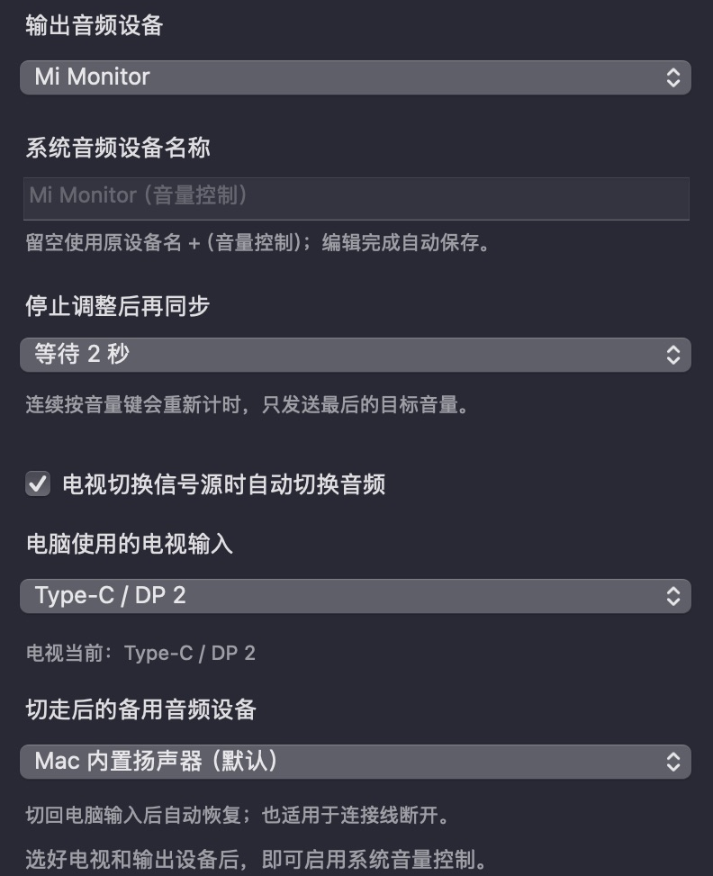

# 小米电视音量 · MiTV Volume

用 macOS 系统音量滑块和音量键控制小米 / Redmi 电视，并同步电视当前音量。音频由用户指定的本地输出设备播放，音量命令通过局域网发送。

[下载安装包](https://github.com/XHFO/MiTV-Volume/releases) · [验证范围](docs/VALIDATION.md) · [第三方声明](THIRD_PARTY_NOTICES.md)

**当前版本：0.6.0 build 17（预发布）。** 支持 macOS 13 及以上，提供 Apple Silicon / Intel 通用应用。应用采用临时签名，尚未经过 Developer ID 签名和 Apple 公证。

## 界面预览（旧版）



以下是 v0.5.0 的历史窗口截图；0.6.0 已改为仅菜单栏操作。v0.5.0 在 macOS 上运行时的真实截图，仅裁剪设置区域；与 [XHFO.NET 官网](https://xhfo.net/#mitv-volume)使用同一素材。截图说明见[素材记录](docs/screenshots/README.md)。

## 功能

- 自动发现局域网电视，无需填写 IP；手动选择声音实际输出的音频设备。
- 使用系统滑块和音量键控制电视，空闲时将电视音量同步回 Mac。
- 自定义音频设备名称；默认使用「原设备名称（音量控制）」。
- 停止调整后再发送音量控制：可选立即、0.3、0.5（默认）、1、1.5、2 秒。连续操作重新计时，电视逐档追赶时不把电脑滑块拉回中间值。
- 电视切走电脑所在输入时，Mac 切到指定备用音频设备；切回后恢复。电脑输入和备用设备均可选择。
- 输出设备断开时隐藏代理，恢复连接后按此前状态恢复输出。
- 仅菜单栏应用，无主窗口和 Dock 图标；电视、输出设备、等待时间、信号源及登录自启均在菜单中设置。
- 可隐藏菜单栏图标；再次打开应用恢复菜单入口。

## 安装与设置

1. 在 [Releases](https://github.com/XHFO/MiTV-Volume/releases) 下载 ZIP，解压后把 `MiTV Volume.app` 放入「应用程序」。
2. 打开应用，允许局域网访问。点击菜单栏扬声器图标，在菜单里选择自动发现的电视及实际音频输出设备。
3. 点击「启用所选电视和设备」。首次启用需要 macOS 管理员授权，声音会短暂中断；应用会自动配置内置音频组件并等待它就绪。
4. 启用后使用系统音量滑块或音量键。设置中的名称和同步等待时间会自动保存。

只有一个 Mac 应用，无需另下安装包或手动安装驱动。系统滑块所需的 HAL 组件内置在应用中，首次启用仍需系统授权；组件安装位置为 `/Library/Audio/Plug-Ins/HAL/MiTVVolumeDriver.driver`。

应用始终在后台运行，不弹主窗口。隐藏菜单栏图标后，再次打开应用即可恢复菜单入口。退出应用时，如果当前使用代理，会切回所选实际输出设备。

### 电视信号源自动切换

在菜单「电视信号源切换 → 电脑使用的电视输入」中选择 Mac 所连接的输入，再开启「切走时自动切换音频」，并选择备用音频设备。

这项功能读取电视自身的当前主输入会话，不依赖拔线。它使用应用内置的 ADB，**电视需要已开启网络调试并允许此 Mac 连接**，无需另外安装电视应用。电视未授权或固件不支持读取时，应用显示失败状态，不会猜测信号源。

约每秒读取一次，连续两次一致后进行切换。读取失败、切换过渡或状态过期时暂停电视音量控制并保留当前音频输出。返回电脑输入时先读取电视音量，再恢复代理；用户在离开期间手动选择其他 Mac 音频设备会取消此次自动恢复。

当前读取方案在一台 Redmi 设备上验证过；其 Type-C 对应 DP 2。不同固件的输入标签和接口可能不同。**Type-C → 游戏输入 → Type-C 的完整真实往返验收尚未完成**，详见[验证记录](docs/VALIDATION.md)。

## 同步行为与限制

- 电视的 `volume/maxVolume` 决定实际刻度；Mac 显示比例，最终按电视整数档对齐。
- 优先尝试签名绝对音量设置，电视不支持时逐档发送音量按键并回读。确认每档生效后立即继续，正常路径不再额外等待 80 + 100 毫秒；回读未变化才等待 80 毫秒重查。跨越较多档位仍受电视逐档接口速度限制。
- 等待与追赶期间，Mac 滑块表示用户目标，不代表电视已到达该音量。达到目标或确认无法达到后再回写实际值。
- 已经发出的请求无法撤回；后续请求使用最新目标。启动和重连会丢弃旧目标，以电视当前音量为准。
- 音频在所选本地设备输出；本项目不通过网络传送音频。代理不再次衰减 PCM，实际音量由电视控制。
- 自动发现仅扫描本机已连接网络的所在 /24 范围，不跨 VLAN。电视能提供 MAC 身份时可在 IP 变化后重新识别；否则需重新选择。
- 现有 Proxy Audio Device 可以保留；本应用使用独立 UID。不要让两个代理互相选择为输出。
- 未做物理遥控器、长期稳定性、整机重启、所有电视固件及 Intel 真机的完整验收。

本项目不提供电视输入源遥控、开关机、方向键或亮度控制。

## 构建与测试

需要安装 Xcode 的 macOS 开发环境。仓库保留了可直接打包的 ADB 通用二进制及第三方声明。

```sh
swift test --disable-sandbox
./scripts/test-driver.sh
./scripts/test-menu-icons.sh
./scripts/build.sh
```

默认生成 `dist/MiTV-Volume-0.6.0.zip`。可通过 `BUILD_DIR`、`DIST_DIR` 指定构建缓存与输出目录。构建不会安装系统音频组件。

目录：

- `Sources/VolumeCore`：协议、音量同步、输入会话解析与输出恢复逻辑。
- `Sources/MiTVVolume`：macOS 菜单栏设置、音频桥接、内置启用流程与电视状态读取。
- `Driver`：修改后的 Proxy Audio Device；原设置应用仅保留为上游源码，不参与交付。
- `Tests`：Swift 自动测试与实际 C++ 驱动入口测试。
- `Resources/ADB`：内置 ADB 及许可声明。授权私钥由运行时管理，不包含在源码或发布包中。

## 来源

- 音频组件基于 [briankendall/proxy-audio-device](https://github.com/briankendall/proxy-audio-device)，基线 `d3d8c8c`，保留 [Unlicense](Driver/LICENSE) 及文件原有声明。
- 电视音量协议参考 [pengchujin/MiTV-Remote](https://github.com/pengchujin/MiTV-Remote)，参照 `bacb9f0`；本项目独立实现客户端，未打包该项目的遥控应用。
- ADB 来自 Android SDK Platform-Tools，保留 [第三方许可声明](Resources/ADB/NOTICE.txt)。

### 图标与外观（0.6.0）

应用图标采用紫色声波构图，由 Apple Icon Composer 的第 27 代 Liquid Glass 渲染，
通过 Xcode actool 生成原生资源和旧版 ICNS 回退。源文档位于 `Resources/AppIcon.icon`。

菜单“音频设备外观 → 设备图标”仅提供五种样式：
显示器、扬声器、耳机、电视、本机 Mac。选择自动保存。
分类只影响外观，不改变实际音频连接方式；本机 Mac 图标由运行电脑的机型决定。

名称由独立的自定义名称设置维护。0.3.6 音频组件让设备名称和数据源标签使用同一个用户名称，
修复控制中心把设备显示成 Speaker / Headphones 的问题。切换图标不会重置名称。
旧组件用户点击“更新音频图标支持…”即可通过应用内流程更新；macOS 会请求管理员授权，
音频会短暂中断。无需独立安装器。更新完成后可重新展开声音面板查看。

应用仍保留十二个已保存的分类值和相应 Core Audio 资源，避免旧设置被重排；
蓝牙、AirPlay 等不再作为新选项展示。若旧设置已选中一个已移除样式，菜单会暂时保留
该项并明确标注，直到用户自行选择其他样式。电视选项使用系统通用电视图标。
